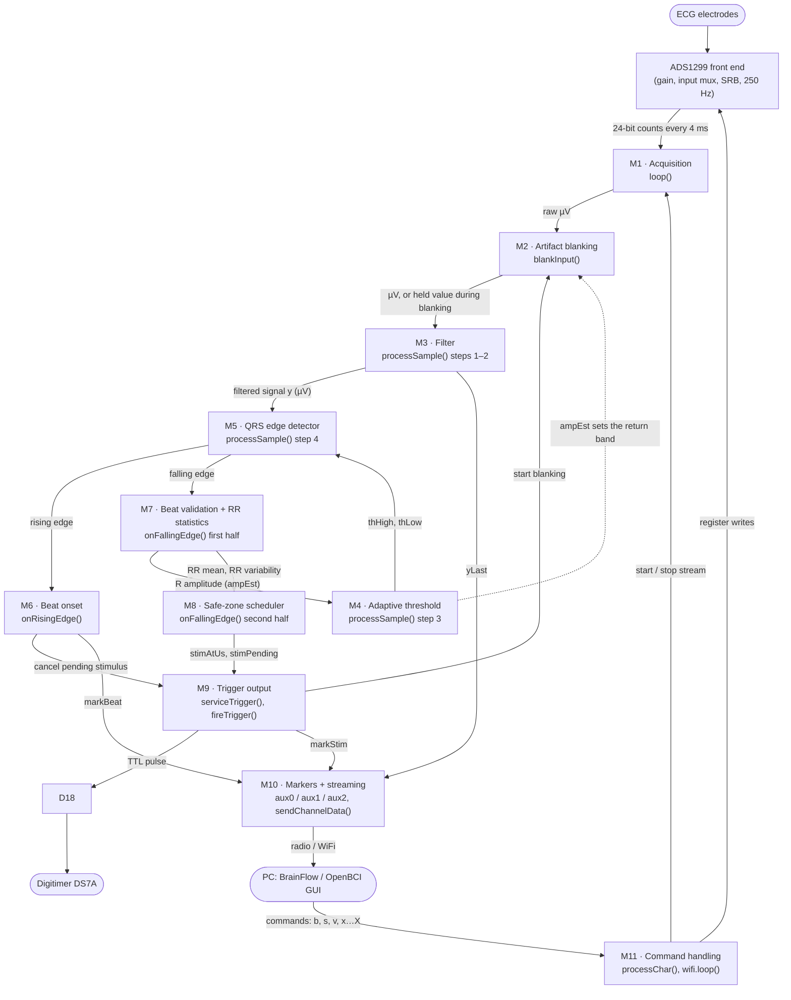
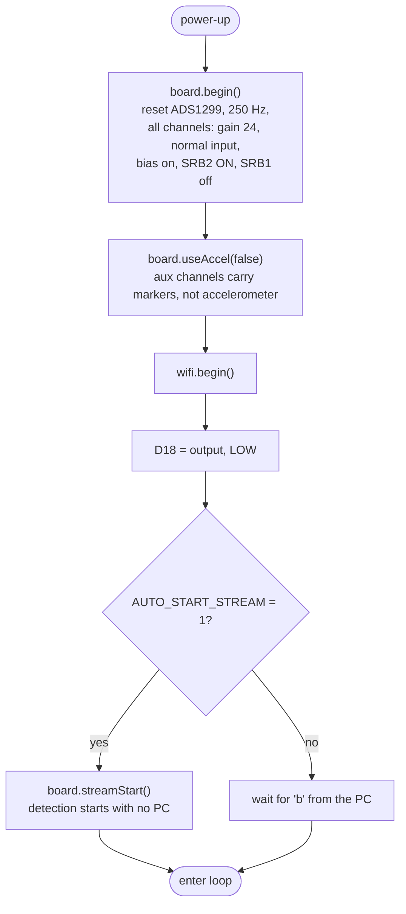
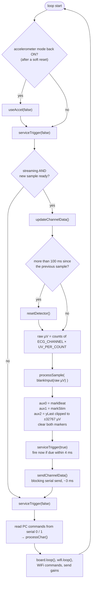
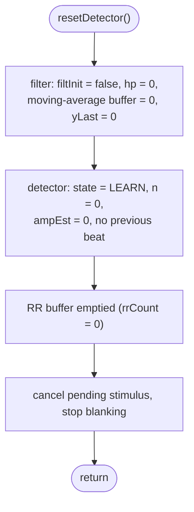
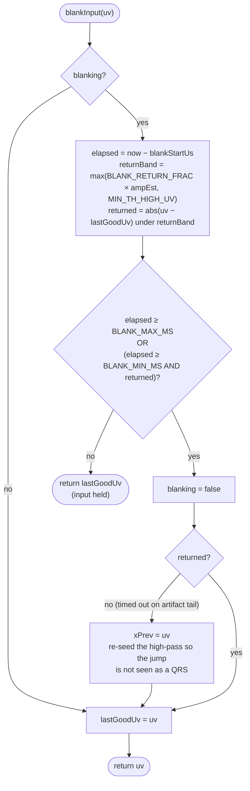
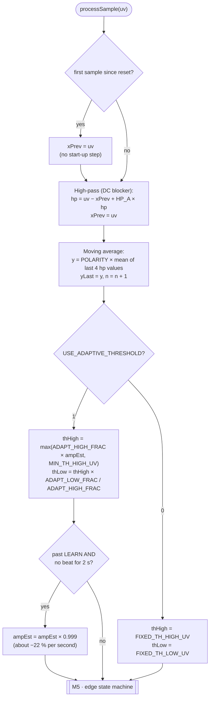
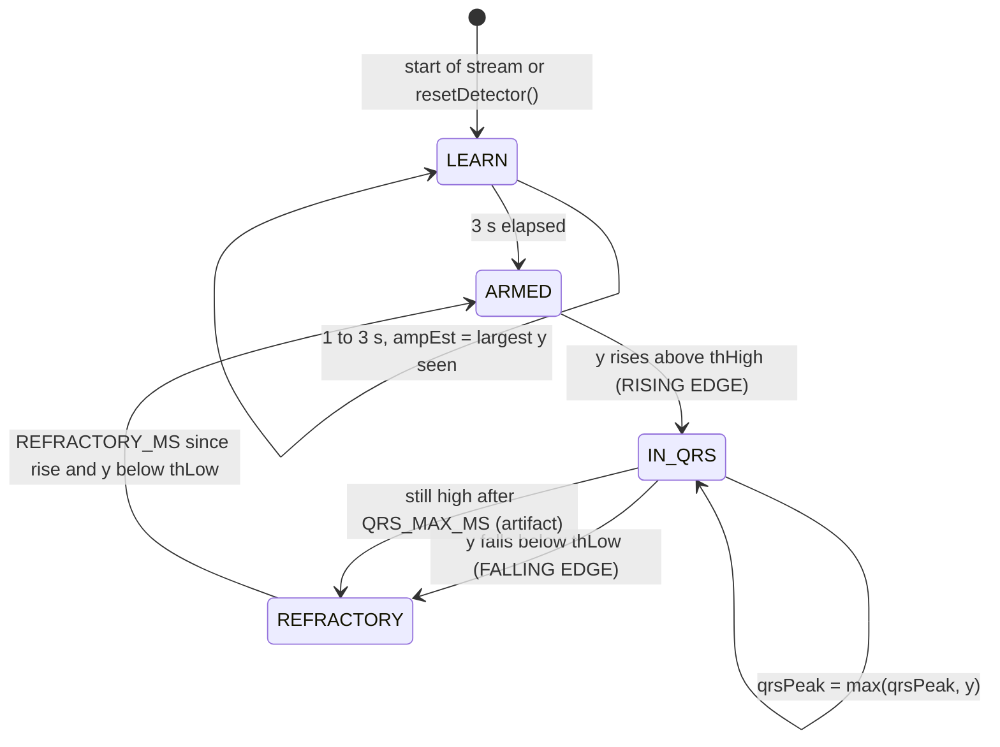
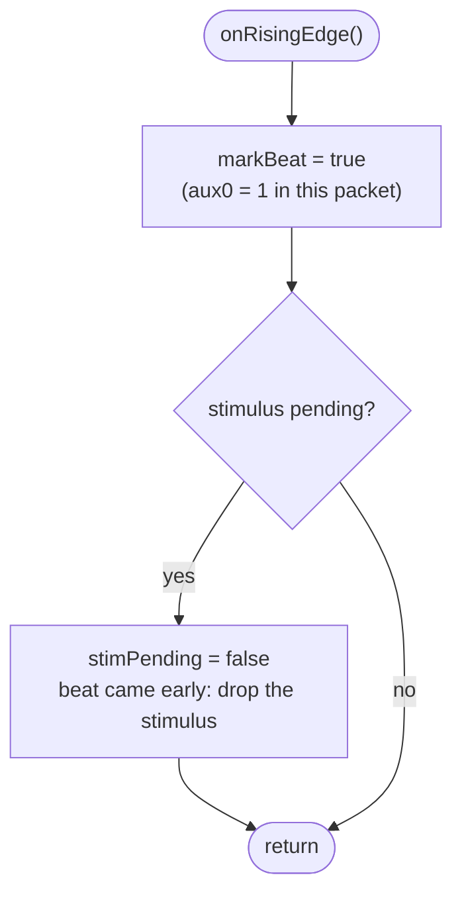
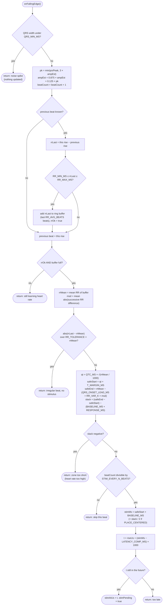
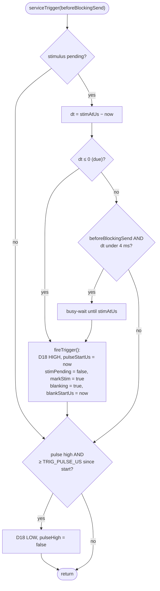

# cyton_rwave_trigger — firmware design

This document describes how [cyton_rwave_trigger.ino](cyton_rwave_trigger.ino) works:

1. [Block diagram](#1-block-diagram): the modules and the signals passed between them
2. [Flowcharts](#2-flowcharts): what happens inside each module
3. [Parameters](#3-parameters): what every setting means and how changing it affects the modules

The firmware runs entirely on the Cyton's PIC32. It detects R-waves on one ECG channel and sends a TTL pulse on pin D18 to a Digitimer DS7A. The pulse is timed so the stimulus lands in the "safe zone" between the end of the T-wave and the next QRS. The PC only monitors; it is not part of the timing path.

---

## 1. Block diagram



| Module | Code | Job |
|---|---|---|
| M0 · Startup | [`setup()`](cyton_rwave_trigger.ino#L327) | Initialise the board and ADS1299 with library defaults, switch the aux channels to marker mode, configure D18. |
| M1 · Acquisition | [`loop()`](cyton_rwave_trigger.ino#L340) | Read each new sample, reset the detector after a data gap, convert the chosen channel to µV. Also the main scheduler: it calls every other module. |
| M2 · Artifact blanking | [`blankInput()`](cyton_rwave_trigger.ino#L153) | After a stimulus, hold the input at the last pre-stimulus value so the DS7A artifact never reaches the filters or the detector. |
| M3 · Filter | [`processSample()`](cyton_rwave_trigger.ino#L268) steps 1–2 | High-pass at ~4.8 Hz (removes electrode offset/drift, shrinks P and T waves) followed by a 4-point moving average (removes 60 Hz and high-frequency noise). |
| M4 · Adaptive threshold | `processSample()` step 3 | Compute the upper and lower detection thresholds from the running R-wave amplitude. Let the amplitude estimate decay if beats stop being found. |
| M5 · QRS edge detector | `processSample()` step 4 | Four-state machine (LEARN → ARMED → IN_QRS → REFRACTORY) that finds the rising and falling edge of each QRS with hysteresis. |
| M6 · Beat onset | [`onRisingEdge()`](cyton_rwave_trigger.ino#L201) | Flag the beat for the PC and cancel any stimulus that hasn't fired yet (the beat came earlier than predicted). |
| M7 · Beat validation + RR statistics | [`onFallingEdge()`](cyton_rwave_trigger.ino#L206) first half | Reject spikes that are too narrow, update the R amplitude, record the RR interval, and compute the mean RR and beat-to-beat variability. |
| M8 · Safe-zone scheduler | `onFallingEdge()` second half | Reject irregular beats, compute the safe zone for this beat, and schedule the trigger time if the 300 ms block fits. |
| M9 · Trigger output | [`serviceTrigger()`](cyton_rwave_trigger.ino#L177), [`fireTrigger()`](cyton_rwave_trigger.ino#L141) | Fire the D18 pulse at the scheduled time, end it after the pulse width, and start blanking. |
| M10 · Markers + streaming | `loop()` | Put the beat marker, stimulus marker and filtered signal into the aux channels and send the packet to the PC. |
| M11 · Command handling | `loop()` → OpenBCI library | Pass PC commands to the library (start/stop stream, channel settings, soft reset). These are the only path by which ADS1299 registers change after startup. |
| — Reset | [`resetDetector()`](cyton_rwave_trigger.ino#L193) | Clear the filter, detector, RR and blanking state so detection starts fresh. |

**Feedback loops to note**

- **Amplitude → threshold:** each valid beat updates `ampEst`, and the thresholds for the next beat are fractions of it. The detector follows slow changes in R-wave size.
- **Trigger → blanking → detector:** firing a stimulus starts blanking, so the detector cannot see its own artifact as a heartbeat.
- **Rising edge → trigger:** a beat that arrives before a pending stimulus cancels it. A stimulus is therefore never delivered on top of an early QRS.

---

## 2. Flowcharts

### M0 · Startup — `setup()`



The firmware does not set any channel registers itself. The ADS1299 configuration is the library default above until the PC sends a channel-settings command (the Python monitor sends `x1060100X`, which turns SRB2 off on channel 1).

### M1 · Acquisition and main loop — `loop()`



`serviceTrigger()` is called three times per pass so the trigger is checked as often as possible. The call with `true` just before the radio send stops the blocking send from delaying a trigger.

### Reset — `resetDetector()`



Called at the first sample of every stream and after any gap of more than 100 ms. Every restart therefore goes through the 3 s learning phase and needs `RR_AVG_BEATS` valid beats before the first stimulus.

### M2 · Artifact blanking — `blankInput()`



### M3 · Filter and M4 · Adaptive threshold — `processSample()` steps 1–3



`USE_ADAPTIVE_THRESHOLD` is a compile-time switch; only one branch exists in the built firmware.

### M5 · QRS edge detector — state machine



| Transition | Actions |
|---|---|
| LEARN, first 1 s | Nothing; lets the high-pass settle. |
| LEARN, 1–3 s | `ampEst` tracks the largest `y`, which seeds the threshold. |
| LEARN → ARMED | `lastBeatN = n` (starts the 2 s "no beat" timer). |
| ARMED → IN_QRS (rising edge) | Record `riseN` (sample number) and `riseUs` (µs timestamp; the stimulus time is measured from here), `qrsPeak = y`, call **M6** `onRisingEdge()`. |
| IN_QRS → REFRACTORY (falling edge) | Call **M7/M8** `onFallingEdge()`. |
| IN_QRS → REFRACTORY (too wide) | Nothing updated. The beat marker was already set and any pending stimulus already cancelled at the rising edge. |
| REFRACTORY → ARMED | Requires both the time limit and the signal back below `thLow`, so a slow T-wave above `thLow` keeps the detector disarmed. |

### M6 · Beat onset — `onRisingEdge()`



### M7 · Beat validation + RR statistics and M8 · Safe-zone scheduler — `onFallingEdge()`



Everything above "abs(rrLast − rrMean)" is M7; everything from there down is M8.

**Safe-zone timing for one beat** (times measured from the detected rising edge):

```
rising edge                                                             predicted next rising edge
t = 0                                                                   t = rrMean
|                                                                       |
|-- qt --|-- T_MARGIN_MS --|-- BASELINE_MS --|-- RESPONSE_MS --|-slack-|-- QRS_ONSET_LEAD_MS + RR_VAR_K·msd --|
         ^ est. T-wave end ^ safeStart       ^ STIMULUS                ^ safeEnd
```

With `PLACE_CENTERED = 1` the slack is split equally before and after the 300 ms block.

### M9 · Trigger output — `serviceTrigger()` and `fireTrigger()`



The rising edge of the pulse is accurate to a few µs. The falling edge happens at the next `serviceTrigger()` call after `TRIG_PULSE_US`, so the pulse is longer than set when the trigger fires just before the blocking radio send (about 3 ms instead of 200 µs). The DS7A triggers on the rising edge, so the stimulus timing is not affected.

### M10 · Markers + streaming

Done inline in `loop()` (see M1). Per sample:

| Aux channel | Value | Meaning |
|---|---|---|
| aux0 | 1 or 0 | 1 on the sample where a rising edge (beat) was detected |
| aux1 | 1 or 0 | 1 on the first packet after a trigger fired |
| aux2 | −32767 … 32767 | Filtered detector signal `y` in µV (flat while blanking). Use it to tune thresholds and `POLARITY`. |

### M11 · Command handling

Characters from the radio (serial 0/1) and the WiFi shield go to the OpenBCI library unchanged. The library handles `b` / `s` (start/stop stream), `v` (soft reset: restores the ADS1299 defaults and turns the accelerometer back on, which M1 undoes), and `x…X` channel settings (written to the ADS1299 registers). The firmware's own code does not check or limit these commands.

---

## 3. Parameters

### 3.1 User settings (top of the sketch)

Changing any of these requires recompiling and uploading.

#### Input and startup

| Parameter | Default | Unit | Used by | Definition and effect |
|---|---|---|---|---|
| `ECG_CHANNEL` | 1 | channel 1–8 | M1 | Which Cyton channel the detector reads. The other channels are streamed but not analysed. |
| `POLARITY` | +1 | ±1 | M3 | Multiplies the filtered signal. The detector only looks for **positive** peaks, so set −1 if the R-wave points down on `aux2`. Wrong polarity means the detector triggers on the S-wave or misses beats. |
| `AUTO_START_STREAM` | 0 | 0/1 | M0 | 1 = start streaming and detecting at power-up with no PC. 0 = wait for `b` from the PC. In standalone mode no channel-settings command is ever sent, so the ADS1299 stays at its defaults (SRB2 on). |
| `ADS_GAIN` | 24.0 | — | M1 | Used **only** to convert counts to µV (`UV_PER_COUNT`). It does not set the hardware gain. If it doesn't match the channel's real gain, every µV value and threshold is off by the ratio of the two. |

#### Detection thresholds (M4, M5)

| Parameter | Default | Unit | Definition and effect |
|---|---|---|---|
| `USE_ADAPTIVE_THRESHOLD` | 1 | 0/1 | 1 = thresholds follow the running R amplitude. 0 = use the two fixed values below. `ampEst` is still tracked in fixed mode, because blanking uses it. |
| `FIXED_TH_HIGH_UV` | 300 | µV | Fixed mode only. Filtered signal must rise above this to start a QRS. Higher = fewer false beats from noise/T-waves, more missed small beats. |
| `FIXED_TH_LOW_UV` | 150 | µV | Fixed mode only. Signal must fall below this to end the QRS (and to leave REFRACTORY). The gap between HIGH and LOW is the hysteresis that stops noise causing repeated edges. |
| `ADAPT_HIGH_FRAC` | 0.50 | fraction | `thHigh = ADAPT_HIGH_FRAC × ampEst`. Higher = more selective (rejects tall T-waves), but beats with a smaller-than-usual R are missed. Lower = more sensitive, more false beats. |
| `ADAPT_LOW_FRAC` | 0.25 | fraction | `thLow = thHigh × ADAPT_LOW_FRAC / ADAPT_HIGH_FRAC` (= 25 % of `ampEst`). Lower = wider hysteresis, falling edge found later, QRS measured wider. Must be below `ADAPT_HIGH_FRAC`. |
| `MIN_TH_HIGH_UV` | 80 | µV | Floor on `thHigh`, so noise alone can't trigger when `ampEst` is small or has decayed. Also the floor on the blanking return band (M2). Should be above the filtered noise level seen on `aux2`. |

#### Beat validation (M5, M7, M8)

| Parameter | Default | Unit | Definition and effect |
|---|---|---|---|
| `REFRACTORY_MS` | 250 | ms | Minimum time after a rising edge before another can be detected. Longer = better rejection of T-waves and double counting; must stay below the shortest real RR (250 ms limits detection to 240 bpm). |
| `QRS_MIN_MS` | 12 | ms | Rising-to-falling widths shorter than this are treated as spikes and ignored (no amplitude, RR or stimulus update). Raise if short noise spikes are counted. |
| `QRS_MAX_MS` | 130 | ms | Wider than this is treated as artifact or saturation: the detector goes straight to REFRACTORY without validating. Lower = stricter, but wide QRS complexes (e.g. bundle-branch block) would be rejected. |
| `RR_MIN_MS` | 400 | ms | Shortest RR accepted into the statistics (150 bpm). RRs outside the range are not stored and that beat can't trigger a stimulus. |
| `RR_MAX_MS` | 1500 | ms | Longest RR accepted (40 bpm). A missed beat produces a double-length RR that is rejected here. |
| `RR_TOLERANCE` | 0.20 | fraction | Skip the stimulus if the last RR differs from the mean by more than this fraction. Lower = stimulates only during very regular rhythm (more skipped beats); higher = accepts more variable beats, with more risk the next beat comes early. |
| `RR_AVG_BEATS` | 8 | beats | Size of the RR history. Sets how many valid beats are needed before the first stimulus, and how quickly the mean and variability follow heart-rate changes. Larger = steadier estimate, slower to adapt and to start. Must be ≥ 2. |

#### Safe-zone timing (M8)

All times are relative to the detected rising edge.

| Parameter | Default | Unit | Definition and effect |
|---|---|---|---|
| `QTC_MS` | **0** | ms | Heart-rate-corrected QT interval. The estimated T-wave end is `QTC_MS × √(RR in s)` (Bazett). Higher = the safe zone starts later. **At 0 the T-wave estimate is turned off** (see note below). |
| `T_MARGIN_MS` | 100 | ms | Extra time added after the estimated T-wave end, since Bazett is approximate. Higher = safer, but the zone gets shorter and fewer beats fit the 300 ms block. |
| `QRS_ONSET_LEAD_MS` | 100 | ms | How long before the detected rising edge the next QRS actually starts. Subtracted from the predicted next beat. Higher = the zone ends earlier. |
| `RR_VAR_K` | 2.5 | × | Multiplier on the measured beat-to-beat RR change (`msd`). The safe zone ends `RR_VAR_K × msd` earlier, so with more variable rhythm, a larger margin is left before the next beat. Higher = safer, fewer eligible beats. |
| `PLACE_CENTERED` | 0 | 0/1 | 0 = put the block right after `safeStart` (all spare time is left before the next beat, the recommended option). 1 = centre the block in the zone. |
| `BASELINE_MS` | 100 | ms | Pre-stimulus baseline inside the zone. The stimulus fires at `safeStart + BASELINE_MS`. |
| `RESPONSE_MS` | 200 | ms | Post-stimulus window that must also fit in the zone. `BASELINE_MS + RESPONSE_MS` (300 ms) is the block that must fit, or the beat is skipped. Larger = fewer eligible beats at higher heart rates. |
| `LATENCY_COMP_MS` | 0 | ms | Measured delay between the true R-wave and its detection (ADS1299 digital filter, the moving average's ~6 ms delay, threshold crossing). Subtracted from the stimulus time; higher = stimulus earlier. Calibrate by comparing D18 with a reference ECG. |
| `STIM_EVERY_N_BEATS` | 1 | beats | Stimulate only when `beatCount` is a multiple of N. `beatCount` counts every validated beat (including skipped ones), so with N = 2 the rate is at most every other beat, and lower if eligible beats are skipped. |

#### Trigger output (M9)

| Parameter | Default | Unit | Definition and effect |
|---|---|---|---|
| `TRIG_PIN` | 18 | pin | Header pin for the trigger. D18 is unused in the default board mode. |
| `TRIG_PULSE_US` | 200 | µs | Minimum pulse width (the DS7A needs ≥ 5 µs). The real width can be longer (see M9). |

#### Artifact blanking (M2)

| Parameter | Default | Unit | Definition and effect |
|---|---|---|---|
| `BLANK_MIN_MS` | 20 | ms | Input is always held for at least this long after a trigger. Should cover the stimulus artifact itself. |
| `BLANK_MAX_MS` | 100 | ms | Blanking always ends by this time, even if the signal hasn't returned. A real QRS cannot be detected while blanking, so keep this well below the time from stimulus to the next beat. |
| `BLANK_RETURN_FRAC` | 0.20 | fraction | Between MIN and MAX, blanking ends when the raw signal is back within `max(BLANK_RETURN_FRAC × ampEst, MIN_TH_HIGH_UV)` of the held value. Lower = waits for a more complete recovery. |

### 3.2 Fixed constants (in the code, not in the settings block)

| Constant | Value | Used by | Meaning |
|---|---|---|---|
| `FS` | 250 Hz | all | Sample rate; must match the ADS1299 (library default). All ms values are rounded to 4 ms samples. |
| `UV_PER_COUNT` | 4.5 V / `ADS_GAIN` / (2²³ − 1) ≈ 0.0224 µV | M1 | Count-to-µV scale. |
| `HP_A` | 0.88 | M3 | High-pass pole. Cutoff ≈ (1 − a)·FS / 2π ≈ 4.8 Hz. Closer to 1 = lower cutoff (keeps more P/T wave and drift). |
| Moving-average length | 4 samples | M3 | 16 ms window; ~−27 dB at 60 Hz, nulls at 62.5 and 125 Hz. Adds ~6 ms delay. |
| Learning time | 1 s settle + 2 s peak search | M5 | Seeds `ampEst` before detection starts. |
| Amplitude update | `0.875 × old + 0.125 × new`, new clamped to 3 × old | M7 | About 8-beat averaging; one large artifact can raise `ampEst` by at most 25 %. |
| Amplitude decay | × 0.999 per sample after 2 s without a beat | M4 | Lets the threshold come down if the R-wave becomes smaller. |
| Pre-send wait window | 4000 µs | M9 | If a trigger is due within 4 ms of the radio send, wait for it first. |
| Gap reset | 100 ms | M1 | Any longer gap between samples restarts the detector. |

### 3.3 Worked examples

Mean RR change `msd` = 20 ms, other settings at their defaults.

| Heart rate (RR) | `QTC_MS` | Est. T-wave end | `safeStart` | `safeEnd` | Slack | Stimulus at | Result |
|---|---|---|---|---|---|---|---|
| 60 bpm (1000 ms) | 0 (current) | 0 ms | 100 ms | 850 ms | 450 ms | 200 ms | Stimulates; block 100–400 ms |
| 75 bpm (800 ms) | 0 (current) | 0 ms | 100 ms | 650 ms | 250 ms | 200 ms | Stimulates; block 100–400 ms |
| 60 bpm (1000 ms) | 420 | 420 ms | 520 ms | 850 ms | 30 ms | 620 ms | Stimulates; block 520–820 ms |
| 75 bpm (800 ms) | 420 | 376 ms | 476 ms | 650 ms | −126 ms | — | Skipped: zone too short |

Highest heart rate at which the 300 ms block still fits (with `msd` = 20 ms): about **109 bpm** with `QTC_MS = 0`, and about **62 bpm** with `QTC_MS = 420`. To stimulate at higher rates with a real QT estimate, reduce `T_MARGIN_MS`, `QRS_ONSET_LEAD_MS`, `RR_VAR_K` or the block length.

### 3.4 Notes on the current settings

- **`QTC_MS = 0` turns off the T-wave estimate.** The safe zone then starts only `T_MARGIN_MS` (100 ms) after the R-wave, and the stimulus fires at 200 ms. That is inside the T-wave for a normal ECG (the T-wave usually ends ~350–450 ms after the R-wave), which is not what the header comment describes. If this is intentional for bench testing, that's fine; for recordings, set it to the subject's QTc (typically 400–440 ms) and check the resulting heart-rate limit above.
- **Default ADS1299 settings have SRB2 on.** Only the PC's channel command turns it off. After power-up, a soft reset (`v`), or in standalone mode, channel 1 uses SRB2 as its reference.
- **`ADS_GAIN` must match the channel gain** set from the PC (`x1060100X` sets gain 24, which matches).


### 3.5 Tests to run + parameters to change

- Because `QTC_MS = 0`, the time between R and trigger should be ~200 ms --> double check the time in the code output. The version used to generate most recent plots may have suboptimal settings. 
- Also adjust `T_MARGIN_MS` to place the trigger in the right spot
- Turn off adaptive amplitude thresholding and adjust low/high cutoffs. 
- Turn on adaptive thresholding and play around with the fraction parameters (`ADAPT_HIGH_FRAC`, `ADAPT_LOW_FRAC`).
- adjust the `RR_TOLERANCE` which skips stim if peak to peak variability is more than this fraction
- adjust `RR_VAR_K`: sets the margin before the next beat; with a more variable beat, it's longer
